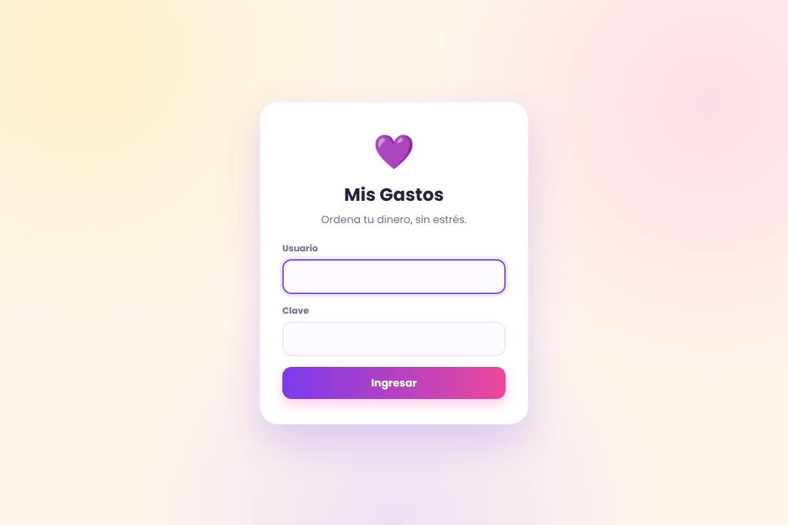
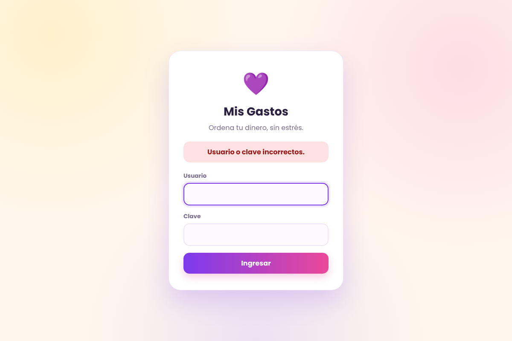
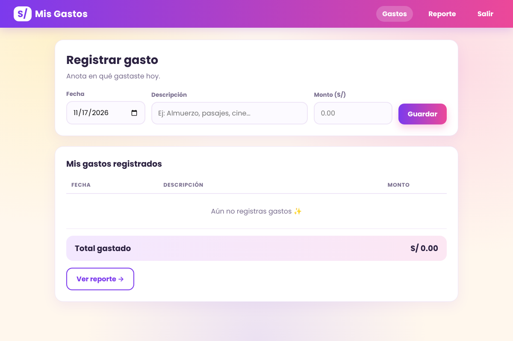
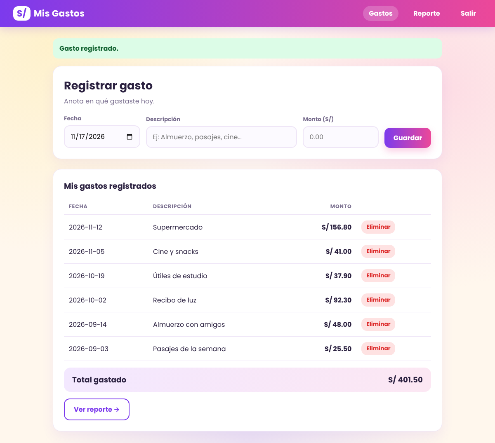
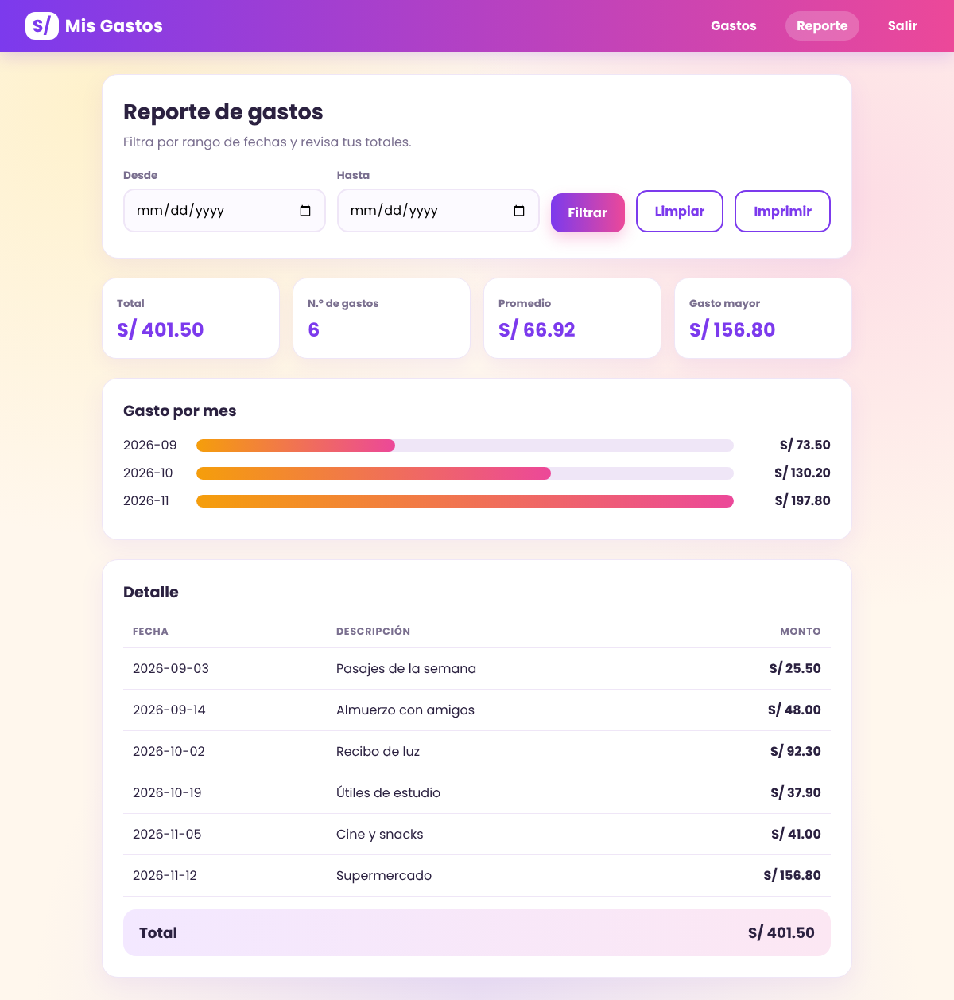
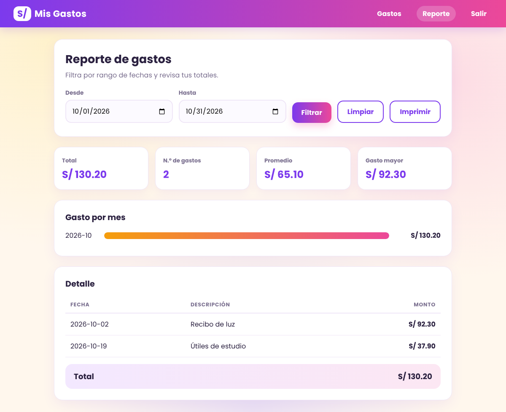

# 💜 Mis Gastos

Aplicación web para **registrar gastos personales** (fecha, descripción y monto) y **generar un reporte**.
Hecha con **Flask**, **Python** y **SQLite**.

**Acceso:** usuario `admin` · clave `123`

---

## Funcionamiento

### 1. Inicio de sesión
Al abrir la app aparece la pantalla de acceso. Solo se puede entrar con las credenciales `admin` / `123`.



Si el usuario o la clave son incorrectos, se muestra un mensaje de error:



### 2. Registrar gastos
Después de ingresar, se llega a la pantalla **Gastos**. Allí se completa el formulario con:

- **Fecha** (por defecto, el día de hoy)
- **Descripción** del gasto
- **Monto** en soles



Cada gasto guardado se agrega a la lista, con el **total gastado** al final. También se puede eliminar un gasto con el botón *Eliminar*.



### 3. Reporte
El menú **Reporte** muestra:

- Total gastado, número de gastos, promedio y gasto mayor
- Gráfico de barras con el **gasto por mes**
- Detalle de todos los gastos



Se puede **filtrar por rango de fechas** (Desde / Hasta) y también **imprimir** el reporte:



### 4. Cerrar sesión
El botón **Salir** del menú cierra la sesión.

---

## Estructura del proyecto

```
SITIO-WEB/
├── app.py              # Aplicación Flask (rutas, login, base de datos)
├── requirements.txt    # Dependencias
├── static/style.css    # Estilos
├── templates/          # Páginas HTML (login, gastos, reporte)
├── docs/               # Capturas usadas en este README
└── gastos.db           # Base de datos SQLite (se crea sola al iniciar)
```

## Cómo ejecutarlo

```bash
git clone https://github.com/luzarcosfuentes-cmd/SITIO-WEB.git
cd SITIO-WEB
python -m venv venv
venv\Scripts\activate        # En Mac/Linux: source venv/bin/activate
pip install -r requirements.txt
python app.py
```

Luego abre <http://127.0.0.1:5000> en el navegador.

## Tecnologías

- Python 3
- Flask
- SQLite (módulo `sqlite3` incluido en Python)
- HTML + CSS
